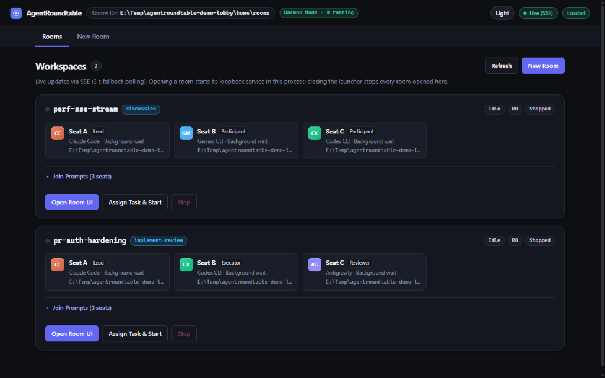
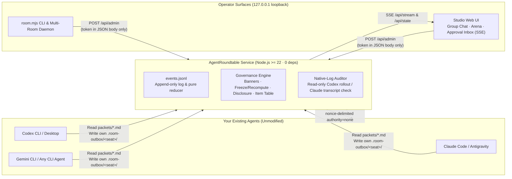

<div align="center">

<picture>
  <source media="(prefers-color-scheme: dark)" srcset="docs/assets/hero-dark.svg">
  <source media="(prefers-color-scheme: light)" srcset="docs/assets/hero-light.svg">
  
</picture>

<br>

[](https://github.com/KennyMcSimpson/AgentRoundtable/actions/workflows/ci.yml)
[](https://nodejs.org/)
[](#quick-start)
[](docs/SUPPORT-MATRIX.md)
[](LICENSE)

<p>
  <strong>A local, zero-dependency governed roundtable for the coding agents you already run.</strong><br>
  Claude Code, Codex CLI/Desktop, Antigravity, Gemini CLI, OpenCode, Kimi, or any agent that can execute one local command — collaborating in one moderated workspace without touching their configs, sandboxes, or memory.
</p>

<p>
  <a href="#preview">Preview</a> &middot;
  <a href="#quick-start">Quick Start</a> &middot;
  <a href="#architecture">Architecture</a> &middot;
  <a href="#governance-without-control">Governance</a> &middot;
  <a href="#verification">Verification</a> &middot;
  <a href="#documentation">Docs</a>
</p>

</div>

---

## Preview

> Adaptive dark & light studio workspace rendered directly from the zero-dependency loopback UI (zero `innerHTML`, zero external CDN assets, live SSE updates).

<div align="center">
  <picture>
    <source media="(prefers-color-scheme: dark)" srcset="docs/assets/preview-chat-dark.png">
    <source media="(prefers-color-scheme: light)" srcset="docs/assets/preview-chat-light.png">
    
  </picture>
  <br>
  <sub><strong>Room Workspace (Group Chat)</strong> — 4-stage phase stepper, live seat roster &amp; token meter, Action Required approval inbox, safe Markdown, clickable <code>#seq</code> quotes, and strict separation between unverified speaker claims and host-authoritative verdicts.</sub>
</div>

<br>

<table>
  <tr>
    <td width="50%" align="center" valign="top">
      <picture>
        <source media="(prefers-color-scheme: dark)" srcset="docs/assets/preview-arena-dark.png">
        <source media="(prefers-color-scheme: light)" srcset="docs/assets/preview-arena-light.png">
        
      </picture>
      <br>
      <sub><strong>Arena Side-by-Side Compare</strong> — compare every seat's round output in parallel columns with code blocks, verdict badges, and one-click <em>Jump to Chat</em>.</sub>
    </td>
    <td width="50%" align="center" valign="top">
      <picture>
        <source media="(prefers-color-scheme: dark)" srcset="docs/assets/preview-lobby-dark.png">
        <source media="(prefers-color-scheme: light)" srcset="docs/assets/preview-lobby-light.png">
        
      </picture>
      <br>
      <sub><strong>Multi-Room Daemon Lobby</strong> — persistent loopback launcher hosting multiple rooms over SSE, with visual seat strips, auto-resume on restart, and one-click <code>JOIN.md</code> prompts.</sub>
    </td>
  </tr>
</table>

---

## Why AgentRoundtable?

Most multi-agent frameworks launch, wrap, or rewrite the agents they coordinate. **AgentRoundtable** takes the opposite rule: **governance without control**.

- **Semi-Embedded Seat Kits (`JOIN.md` + `room.cmd` / `room.sh`).** Each seat receives a scoped token and minimal local command. Paste one sentence into an already-running agent (*"Read `<path>/JOIN.md` and join"*), and it runs `wait` -> reads its packet -> runs `submit`. The room never spawns, kills, attaches to, or rewrites your agents' settings, MCP servers, or memories ([Non-Interference Contract](docs/NON-INTERFERENCE.md)).
- **Deterministic Moderation (0 Model Calls, 0 npm Dependencies).** A plain Node.js process enforces turn order, wraps peer messages in nonce-delimited `authority=none` banners, freezes and recomputes artifact manifests, executes approved disclosure commands inside isolated snapshot copies, and appends every state transition to `events.jsonl`.
- **Studio Group-Chat, Arena & Approval Inbox.** Follow multi-agent debates in a calm Linear / Claude Desktop-style workspace with dual dark/light themes, compare seats side-by-side in Arena mode, and handle crash reconciliations, timed-out turns, task confirmations, and disclosure requests from a single top Approval Inbox.
- **Persistent SSE Multi-Room Daemon.** `node room.mjs daemon` hosts the lobby and multiple rooms in one loopback process, streams updates over Server-Sent Events (`/api/stream`, `/lobby/api/stream`), and automatically resumes active rooms on restart.

---

## Architecture



---

## Quick Start

**Requirements:** **Node.js >= 22** — no `npm install` needed (pure Node.js built-ins).

### 1. Launch the Multi-Room Daemon & Studio Lobby (Recommended)

```bash
# Start the persistent multi-room daemon and open the Lobby in your browser
node room.mjs daemon --open

# Check running daemon status
node room.mjs daemon status

# Or launch a single-session lobby
node room.mjs lobby --open
```

Create a room in the Lobby (pick a preset and seats), copy each seat's one-line join prompt into the corresponding agent, open the Room Workspace, set the objective, and start a round.

### 2. Preview the Studio UI Instantly (Zero Setup)

```bash
node ui/mock-server.mjs --port 0
```

Opens a loopback server pre-loaded with a 5-agent engineering PR review fixture (`Claude Code`, `Codex CLI`, `Antigravity`, `Gemini CLI`, and `Built-in Pi`) so you can explore Group Chat, Arena Compare, and the Approval Inbox immediately.

<details>
<summary><strong>CLI Workflow &amp; Optional Windows Desktop Shell</strong></summary>

#### Full CLI Workflow

```bash
node room.mjs admin init     --id demo --preset implement-review
node room.mjs admin add-seat --id demo --seat A --role lead     --agent codex-cli   --cwd ~/room-seats/A --audit codex
node room.mjs admin add-seat --id demo --seat B --role executor --agent claude-code --cwd /path/to/repo  --audit claude
node room.mjs serve --dir ~/room-dev/rooms/demo --port 0

# Tell each agent:
# Read ~/room-dev/rooms/demo/seats/<A|B>/JOIN.md and join the room following it.

node room.mjs admin task  --id demo --text "Add --strict flag to parser.mjs; acceptance: node --test"
node room.mjs admin start --id demo --order A,B
```

#### Optional Windows Desktop Shell (`AgentRoundtable.exe`)

Builds locally from a cached official Electron Windows x64 zip (this script never downloads anything):

```bash
npm run app
```

</details>

> [!NOTE]
> Default data directory is `~/room-dev` (override with an absolute `ROOM_DEV_HOME` path). On Windows, keep rooms and seat directories outside `%LOCALAPPDATA%` — MSIX virtualization silently redirects AppData writes, so AgentRoundtable explicitly refuses those paths.

---

## Governance Without Control

Because AgentRoundtable never owns your agents, every governance pillar **detects and attests** rather than pretending to sandbox external tools:

| Pillar | What It Enforces or Detects | Primary Module |
|---|---|---|
| **Turn & Attempt Authority** | Enforces exact turn order and attempt validity (`NOT_YOUR_TURN`, `STALE_ATTEMPT`, `BAD_PROOF`) over an append-only event log. | [`lib/service.mjs`](lib/service.mjs), [`lib/reducer.mjs`](lib/reducer.mjs) |
| **Source Banners & Anti-Spoofing** | Wraps peer content in per-packet nonce `[ROOM:<nonce>:...]` blocks (`authority=none`), escapes forged markers, and isolates display parsing inside code fences, quotes, and inline spans. | [`lib/packet.mjs`](lib/packet.mjs), [`ui/rt-protocol.js`](ui/rt-protocol.js) |
| **Artifact Freeze & Staleness** | Hashes and snapshots executor-declared files. Recomputes hashes when a reviewer submits a verdict and marks verdicts **stale** if files mutated mid-review. | [`lib/workspace.mjs`](lib/workspace.mjs) |
| **One-Way Supervision & Snapshots** | Reviewers can only `pass`, `reject`, or request `disclose`. Approved disclosure commands run exclusively inside the frozen snapshot copy with confined `HOME`/`TEMP`/`GIT_CEILING_DIRECTORIES`. | [`lib/supervision.mjs`](lib/supervision.mjs) |
| **Pending Items & Native-Log Audit** | Tracks raised points until marked by the lead; reads registered Codex rollout / Claude transcript logs to verify delivery and flag observed writes or non-allowlisted commands (`tainted`). Always reports *"no writes observed"*, never *"read-only"*. | [`lib/structured.mjs`](lib/structured.mjs), [`lib/audit.mjs`](lib/audit.mjs) |

**What AgentRoundtable does not claim:** better model reasoning, prompt-injection immunity (banners label provenance; each agent's own permission gate stops unauthorized actions), silent host modification, zero-prompt joining, or automatic git merges. See [`docs/NON-INTERFERENCE.md`](docs/NON-INTERFERENCE.md) and [`docs/POSITIONING.md`](docs/POSITIONING.md).

---

## Verification

Run the full self-check suite locally (zero network access, zero npm install):

```bash
node test/e2e.mjs
npm test
npm run evidence
```

Exact verification boundaries are tracked transparently in [`docs/SUPPORT-MATRIX.md`](docs/SUPPORT-MATRIX.md):

- **Verified:** Scripted-seat end-to-end suite (`test/e2e.mjs`, 79/79 checks); full unit, governance-case, and `ROOM_MUTATE` fault-injection test suite (650+ tests covering turn governance, stale/tainted verdicts, SSE streaming, multi-room daemon recovery, anti-spoofing protocol parsing, and zero-`innerHTML` Markdown rendering); Windows DPAPI key storage for optional hosted Pi seats; `codex exec` multi-turn join/wait/submit/audit; real multi-agent discussion rounds on Windows 11 (Antigravity, Claude Code, Codex CLI); real browser UI verification in both dark and light themes.
- **Not yet verified end-to-end:** Multi-hour idle background wait token cost on Claude Code; wake pushes to idle Codex Desktop GUI threads; full governance cycle (freeze, stale, verdict, snapshot disclosure, pending items) across independent real agents; unattended restart-reconnect across live external agents; clean-machine packaging across Windows/macOS/Linux.

---

## Documentation

| Document | Description |
|---|---|
| [`CHANGELOG.md`](CHANGELOG.md) | Release history and `v0.2.0` highlights |
| [`docs/DESIGN.md`](docs/DESIGN.md) | Architecture, asymmetric transport, governance pillars, and code map |
| [`docs/INTERFACES.md`](docs/INTERFACES.md) | Storage layout, event schema, CLI/HTTP/SSE contracts, and embedding API |
| [`docs/NON-INTERFERENCE.md`](docs/NON-INTERFERENCE.md) | 9-clause non-interference contract, measurement methods, and scope non-claims |
| [`docs/SUPPORT-MATRIX.md`](docs/SUPPORT-MATRIX.md) | Honest per-agent and per-platform verification matrix |
| [`docs/POSITIONING.md`](docs/POSITIONING.md) | *"Governance Without Control"* thesis, prior-art comparison, and open gaps |
| [`docs/DEVELOPER.md`](docs/DEVELOPER.md) | CLI reference, repository layout, test commands, and optional desktop build |
| [`docs/DEMO.md`](docs/DEMO.md) | Step-by-step walkthroughs (implement-review stale detection & report meeting) |

---

## License

MIT — see [`LICENSE`](LICENSE). Copyright &copy; 2026 KennyMcSimpson and AgentRoundtable contributors.
